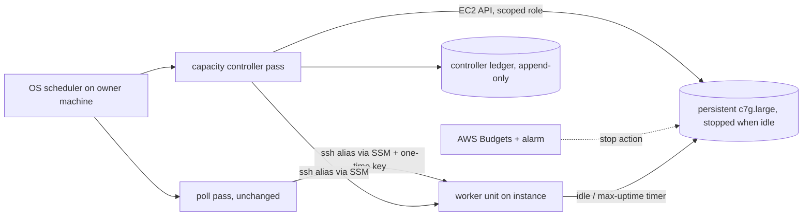

# Private managed capacity on AWS: cost and design study

Status: Proposed — awaiting owner approval. Written 2026-11-02. Source
baseline: `d8a8bb103c7ec2fd63d077057c189bbae3597347`. This is a study. It
accepts no design, changes no code, and created, modified, started, or
stopped no AWS resource. Prices were read on 2026-11-02 (see
[Price card](#price-card)).

It follows the [private capacity investigation](managed-capacity.md), which
left provider, credentials, lifecycle, and cost policy open. The scope is
**private** capacity: the owner's own trusted repositories on the owner's
AWS account. Serving unrelated customers is a separate milestone under the
[PRD non-goals](../prd.md#non-goals) and is not designed here.

## Summary

**Recommendation.** Run one persistent Graviton instance (`c7g.large`,
2 vCPU, 4 GiB, arm64) in `us-west-2`. Keep it **stopped** when idle and
start it only when there is work. Put it in a public subnet with an
auto-assigned public IPv4 address, **no NAT gateway**, and **no inbound
security-group rules**. The owner's machine reaches it with the existing
`ssh -o BatchMode=yes` placement, carried over SSM Session Manager. Each
connection uses a 60-second key pushed through EC2 Instance Connect, so
no long-lived key is stored on the instance. Start on-demand. Move to Spot
once a drill shows that an interruption ends as `lost`/`error` and never
as `success`. Guardrails sit at three layers: the instance powers itself
off when idle, the controller enforces caps and sweeps orphans by tag, and
AWS Budgets alerts and acts.

At the expected light usage this costs about **10 USD/month on-demand**
and **7 USD/month on Spot**, against an existing comparable budget line of
about 20 USD/month. Moderate usage fits that line only on Spot. A NAT
gateway alone (32.85 USD/month) or an always-on instance (36–60 USD/month)
would exceed it, so both are rejected.

### Scenario monthly cost (reference design, `c7g.large`, us-west-2)

All figures are USD per month and use the formulas in
[Cost model](#cost-model). Spot uses the highest `c7g.large` Spot price
observed in any us-west-2 zone over 2026-10-26 to 2026-11-02 (0.0402/h).
That is a planning rate, not a quote.

| Scenario | Instance-hours | On-demand | Spot | Fits ~20 USD? |
| --- | --- | --- | --- | --- |
| Idle / off (stopped all month) | 0 | 2.95 | 2.95 | Yes |
| Light (about 3 billable h/day) | 90 | 9.93 | 7.02 | Yes |
| Moderate (about 8 billable h/day) | 240 | 21.55 | 13.80 | Spot only |
| Light month plus one burst day (24 h on one instance) | 111 | 11.55 | 7.97 | Yes |
| One burst day, cap 3 (3 × 10 h), added to any month | +30 | +2.39 | +1.42 | Depends on base |
| Always on (rejected) | 730 | 59.53 | 35.95 | No |
| Any design with a NAT gateway (rejected) | — | +32.85 minimum | +32.85 minimum | No |

Fixed monthly costs in every row: 30 GiB gp3 root volume 2.40, one 10 GB
golden-image snapshot 0.50, and a lifecycle log trickle of 0.05. Public
IPv4 costs 0.005 per running hour and is already counted in each row.

## Scope and what exists today

Implemented behavior relevant to remote capacity, at the source baseline:

- **Transport.** `poll --place` entries may name an SSH destination.
  `_ssh_run` in [`poll.py`](../../src/execution_core/poll.py) runs
  `ssh -o BatchMode=yes HOST -- ...`. The host string must match
  `_SSH_HOST`, so an `ssh_config` alias is accepted. The remote command
  talks only to the worker's Unix socket. The worker opens no network
  listener ([architecture](../design/architecture.md#local-access)).
- **Placement.** `Pass._classify` checks reachability, readiness, runner
  image digest, and repository origin. `_count_active` counts queued and
  running runs against `cap`. A recorded claim stays on its place, even
  when the place is unreachable or its run is lost. An unreachable place
  is skipped and is not replaced. Work with no eligible place is left
  unrecorded, and its tip is held for a later pass. The pass summary lists
  each skipped place and the reason. It does not report how many jobs
  were left unplaced.
- **Recovery.** `Worker._reconcile_interrupted` in
  [`worker.py`](../../src/execution_core/worker.py) records a running
  attempt that was interrupted by a worker stop as `lost`, with
  `WORKER_INTERRUPTED`. It removes only that attempt's owned container
  and never runs the attempt again. If cleanup is not confirmed, it
  records `cleanup: unresolved` and blocks new workflow attempts.
- **Reporting.** `github_state` in
  [`status.py`](../../src/execution_core/status.py) maps only
  `succeeded` with exit code 0 to `success`. `lost` and `cancelled` map
  to `error`. Poll cancels a queued run 24 hours after acceptance.
- **Storage.** [`disk.py`](../../src/execution_core/disk.py) gives each
  state directory a default budget of `10 * 1024 * 1024 * 1024` bytes,
  plus 90-day and 100-folder retention for finished runs.
- **Host install.** The [worker unit](../design/worker-unit.md) is a
  hardened systemd user unit with fixed paths under `/var/lib/rookrunner`.
  The second dogfood host is installed by hand
  ([Linux host install](../design/linux-host-install.md)). Its runner
  image is built on the host for that host's architecture. Today's hosts
  carry no App key, no `--docker-socket`, and no listen socket
  ([Linux host worker](../design/linux-host-worker.md)).
- **Secrets and identity.** File secrets, the job token, and OIDC
  issuance are designed for one local worker
  ([secrets](../design/secrets.md),
  [OIDC](../design/oidc-identity-tokens.md)). The
  [remote worker requirements](remote-workers.md) leave secret delivery
  to remote hosts open.

The design below keeps all of these. It adds a capacity controller that
manages the power state and lifecycle of AWS instances around unchanged
workers. The only engine changes it proposes are small ones, listed in
[Proposed engine changes](#proposed-engine-changes).

## Price card

All prices are for us-west-2 (US West, Oregon), Linux, shared tenancy,
USD. They were read on **2026-11-02** at about 09:50 UTC. "API" means the
AWS Price List API (`pricing get-products`, a read-only call whose
endpoint is in us-east-1). The effective date shown is the one the API
returned for the price. "Spot API" means `ec2 describe-spot-price-history`
(read-only) for Linux/UNIX over 2026-10-26 to 2026-11-02, across the four
us-west-2 zones. Zone letters map to different physical zones in
different accounts, so this study cites no zone.

### Compute

| Type | Arch | vCPU / GiB | On-demand /h | Spot 7-day range /h | Source |
| --- | --- | --- | --- | --- | --- |
| t4g.medium | arm64 (Graviton2) | 2 / 4 | 0.0336 | 0.0131–0.0162 | API, eff. 2026-10-01; Spot API |
| t4g.large | arm64 (Graviton2) | 2 / 8 | 0.0672 | 0.0243–0.0310 | same |
| c7g.large | arm64 (Graviton3) | 2 / 4 | 0.0725 | 0.0249–0.0402 | same |
| m7g.large | arm64 (Graviton3) | 2 / 8 | 0.0816 | 0.0275–0.0376 | same |
| c8g.large | arm64 (Graviton4) | 2 / 4 | 0.07976 | 0.0238–0.0373 | same |
| c7g.xlarge | arm64 (Graviton3) | 4 / 8 | 0.1450 | 0.0504–0.0894 | same |
| t3a.large | x86_64 (AMD) | 2 / 8 | 0.0752 | 0.0358–0.0439 | same |
| t3.large | x86_64 (Intel) | 2 / 8 | 0.0832 | 0.0301–0.0376 | same |
| c7i.large | x86_64 (Intel) | 2 / 4 | 0.08925 | 0.0268–0.0445 | same |
| c7a.large | x86_64 (AMD) | 2 / 4 | 0.10264 | 0.0420–0.0605 | same |
| m7i.large | x86_64 (Intel) | 2 / 8 | 0.1008 | 0.0397–0.0515 | same |

T-family surplus CPU credits (unlimited mode) cost 0.04 per vCPU-hour for
t4g and 0.05 for t3/t3a on Linux (API, eff. 2026-10-01). On-demand Linux
is billed per second with a 60-second minimum
([EC2 on-demand pricing](https://aws.amazon.com/ec2/pricing/on-demand/)).

### Storage, network, and services

| Item | Price | Source |
| --- | --- | --- |
| EBS gp3 storage | 0.08 per GB-month | API, eff. 2026-10-01 |
| gp3 IOPS above 3,000 baseline | 0.005 per IOPS-month | API; baseline from [EBS pricing](https://aws.amazon.com/ebs/pricing/) |
| gp3 throughput above 125 MB/s baseline | 0.04 per MiB/s-month | same |
| EBS snapshot (standard), incremental | 0.05 per GB-month | API; incremental per EBS pricing page |
| EBS snapshot archive | 0.0125 per GB-month, 90-day minimum | API |
| Public IPv4 address, in use or idle | 0.005 per hour (3.65 per 730 h) | API (AmazonVPC) |
| NAT gateway | 0.045 per hour (32.85 per 730 h) plus 0.045 per GB processed | API |
| VPC interface endpoint | 0.01 per hour per endpoint per zone, plus 0.01 per GB | API (AmazonVPC) |
| Data transfer in from the internet | 0 (no inbound rate is published) | API returned no inbound price |
| Data transfer out to the internet | 0.09 per GB for the first 10 TB, after the free allowance | API, eff. 2026-06-01 |
| Free data transfer out | 100 GB per month, pooled across all services and Regions in the account | EC2 on-demand pricing page |
| Inter-zone / regional transfer | 0.01 per GB each way | API |
| CloudWatch Logs ingestion (custom) | 0.50 per GB | API |
| CloudWatch Logs storage | 0.03 per GB-month | API |
| CloudWatch alarm (standard resolution) | 0.10 per alarm-month | API |
| S3 Standard storage | 0.023 per GB-month for the first 50 TB | API |
| S3 PUT/COPY/POST/LIST | 0.005 per 1,000 | API |
| S3 GET and other | 0.004 per 10,000 | API |
| EKS cluster (for comparison) | 0.10 per hour (73 per 730 h) | API |
| AWS Budgets | Monitoring free. First two action-enabled budgets free, then 0.10/day each. Reports 0.01 each | [Budgets pricing](https://aws.amazon.com/aws-cost-management/aws-budgets/pricing/) |
| Session Manager | "No additional charges for usage on Amazon EC2 instances" | [Systems Manager pricing](https://aws.amazon.com/systems-manager/pricing/) |

**Free Tier.** On 2026-11-02 the [Free Tier page](https://aws.amazon.com/free/)
offered new accounts up to 200 USD in credits on a free plan lasting up to
six months. That expires, and it does not apply to an existing account.
This study does not count it. The 100 GB per month of free data transfer
out is a standing allowance and is the only free item the model relies
on. That allowance is shared with everything else in the account.

## Cost model

### Formulas

Let `H` be billable instance-hours in the month, `r` the hourly instance
rate, `V` the root volume size in GiB, `S` the golden-image snapshot data
in GB, `E` the GB sent out to the internet beyond the free allowance, and
`L` the GB of logs ingested into CloudWatch.

```
monthly = H*r                 compute
        + H*0.005             public IPv4 while running
        + V*0.08              gp3 root volume, charged while it exists (also when stopped)
        + S*0.05              golden image snapshot(s), billed on used blocks
        + E*0.09              egress beyond the 100 GB pooled allowance
        + L*0.50 + L*0.03     CloudWatch Logs ingest and first month storage
        + A*0.10              CloudWatch alarms, if any beyond a free allowance
```

`H` is the sum over power-on sessions of
`boot + job time + idle tail`. A session starts when the controller sees
demand and ends when the instance has been idle for the idle-tail period.
Example for the **light** row: 4 sessions a day × (1 min boot + 30 min of
jobs + 15 min idle tail) = 184 min a day ≈ 3.07 h, or about 92 h in a
30-day month. The table uses 90 h. **Moderate** is about 6 sessions a day
of 80 minutes each, or 8 h a day and 240 h a month.

Reference inputs: `V = 30`, `S = 10`, `E = 0`, `L = 0.1` (lifecycle
events only, no job logs; 0.05 USD), `A = 0` (see guardrails).

### Scenario details

| Scenario | Compute (OD / Spot) | IPv4 | gp3 30 GiB | Snapshot 10 GB | Logs | Total (OD / Spot) |
| --- | --- | --- | --- | --- | --- | --- |
| Idle / off, 0 h | 0 / 0 | 0 | 2.40 | 0.50 | 0.05 | 2.95 / 2.95 |
| Light, 90 h | 6.53 / 3.62 | 0.45 | 2.40 | 0.50 | 0.05 | 9.93 / 7.02 |
| Moderate, 240 h | 17.40 / 9.65 | 1.20 | 2.40 | 0.50 | 0.05 | 21.55 / 13.80 |
| Light + burst day, 111 h | 8.05 / 4.46 | 0.56 | 2.40 | 0.50 | 0.05 | 11.55 / 7.97 |
| Always on, 730 h | 52.93 / 29.35 | 3.65 | 2.40 | 0.50 | 0.05 | 59.53 / 35.95 |

**Burst day.** With a cap of one instance, a burst day means the instance
runs 24 h instead of about 3 h. That adds 21 h × (0.0725 + 0.005) =
1.63 USD on-demand. Excess work waits in the worker queue. Poll cancels
a run that stays queued for 24 hours and reports it as `error`. With a cap
of three, three instances run 10 h each: 30 instance-hours, or about
2.39 USD for the day on-demand. That includes about 0.07 for the two
helpers' 30 GiB volumes, which exist for that day only. Helpers need their
own state, and their lifecycle is covered under
[fresh instances](#fresh-instance-per-job).

**Sensitivity.** Each extra 10 GB of root volume adds 0.80 USD/month,
whether the instance runs or not. Each extra 10 h of on-demand running
adds 0.78. Ten GB of egress beyond the free allowance adds 0.90. Shipping
1 GB/month of job logs to CloudWatch adds 0.53. A NAT gateway adds 32.85
before it moves a single byte.

### On-demand vs Spot

Over the seven days read, `c7g.large` Spot ranged from 0.0249 to 0.0402
an hour, 45–66% below on-demand. That is the difference between moderate
usage fitting the budget (13.80) and not fitting it (21.55). Spot brings
three costs:

1. **Interruption.** AWS gives a two-minute notice through instance
   metadata and EventBridge, on a best-effort basis
   ([Spot interruption notices](https://docs.aws.amazon.com/AWSEC2/latest/UserGuide/spot-instance-termination-notices.html)).
   A job running at that moment ends `lost`, and its commit status becomes
   `error`. The owner reruns it. CI jobs here are short and restartable,
   so this is acceptable once proven.
2. **Start failures.** Starting a stopped Spot instance can fail for lack
   of capacity. The controller must treat that as "no capacity", not as a
   run failure, and may fall back to on-demand only if the owner allows it
   (open question 3).
3. **Lifecycle constraints.** Stop/start on Spot requires a persistent
   Spot request with stop as the interruption behavior and an EBS root
   volume. This must be verified against current EC2 documentation before
   it is adopted.

Proposal: launch on-demand, and switch after the
[interruption drill](#validation-plan-for-an-accepted-design) passes.

### Graviton vs x86

For a 2 vCPU non-burstable instance, `c7g.large` costs 0.0725/h. The x86
equivalents cost more: `c7i.large` 0.08925 (23% more) and `c7a.large`
0.10264 (42% more). The cheapest x86 option, `t3a.large`, is burstable
(see below). Graviton also matches the arm64 runner-image parent already
documented for the owner's own machine
([Linux host install](../design/linux-host-install.md) builds a separate
x86_64 image for the x86 host). Tools in the current workflows publish
aarch64 Linux builds. The [scorecard workflow](../../.github/workflows/scorecard.yml)
already selects `aarch64` assets for `sc` and `uv`. The risk is a
repository whose workflow downloads an x86-only binary, or whose results
depend on the architecture. That is a per-repository check (open question
5), not a reason to pay the x86 premium everywhere.

The x86 Spot price is sometimes lower than Graviton Spot. `c7i.large`
ranged 0.0268–0.0445 against 0.0249–0.0402 for `c7g.large`. On Spot,
architecture is a weak cost lever. Choose it for image compatibility.

### Burstable (t4g) vs fixed performance (c7g)

`t4g.medium` lists at 0.0336/h, under half of `c7g.large`. However, t4g
defaults to unlimited mode, and a T instance earns credits only at its
baseline rate (20% per vCPU for t4g.medium, 30% for t4g.large). A CI job
keeps both vCPUs busy. Full load therefore costs
`0.0336 + 2 × (1 − 0.20) × 0.04 = 0.0976`/h for t4g.medium, and
`0.0672 + 2 × (1 − 0.30) × 0.04 = 0.1232`/h for t4g.large. Both are
higher than `c7g.large`. The same calculation puts `t3a.large` at 0.1452.
Burstable types are cheaper only when average CPU stays near the baseline.
That is true of an idle-but-on instance, not of compiling and testing.
The design keeps the instance off when idle, so `c7g.large` is the better
default. `t4g.medium` remains a reasonable choice if measured jobs turn out
to be I/O bound (open question 4).

### Instance lifecycle models

| Model | Cost shape | What it keeps | Fit |
| --- | --- | --- | --- |
| **Stop/start one persistent instance** (recommended) | Volume charge (2.40) all month. Compute and IPv4 only while on. Each session pays one boot and one idle tail | Worker state directory, run records, the content-addressed action store, Docker images and layers, and build caches inside the workspace image. The existing restart reconciliation works unchanged | Best at light and moderate usage |
| Fresh instance per job | No standing volume. Pays a snapshot for the image (0.50). Every job pays boot plus bootstrap (60 s minimum billing) and runs cold | Nothing. Logs, artifacts, and the run record must be exported before termination, or they are lost with the volume | Worse here; see below |
| Warm pool of one (always running) | 59.53 on-demand, 35.95 on Spot | Everything | Over budget; rejected |

<a id="fresh-instance-per-job"></a>
**Why not a fresh instance per job.** A 10-minute job with a 3-minute
boot and bootstrap costs about `13/60 × (0.0725 + 0.005) ≈ 0.017` USD,
roughly the same per job as stop/start with a shared idle tail. The other
costs come out against it:

- The worker's durable run store, which recovery and reporting rely on,
  is destroyed at termination. Poll keeps the claim on a place that no
  longer exists. Today that leaves the commit status `pending` until an
  operator intervenes ([Proposed engine changes](#proposed-engine-changes),
  item 2).
- A volume restored from a snapshot loads blocks lazily from S3. A cold
  image therefore reads slowly the first time. Fast Snapshot Restore
  avoids that, but it is billed per snapshot per zone and is not
  considered here.
- Every job reinstalls and redownloads what a persistent instance would
  already hold. That adds time, which is billed, and download volume.
- It needs logs and artifacts exported, for example to S3. That brings
  the S3 cost and an instance-profile write permission that the
  recommended design avoids.

Fresh instances remain the right model for **untrusted or multi-tenant**
work, where reuse is a security problem. That is the separate
customer-facing milestone. They are also a fallback for burst helpers.

### EBS sizing and image storage

- **Root volume.** 30 GiB gp3 at the free baseline (3,000 IOPS,
  125 MB/s), 2.40 a month. This holds the OS (about 4–6 GB), Docker and
  the runner image (about 1–3 GB), and the worker state budget. That
  budget defaults to 10 GiB and should be set lower, for example 8 GiB,
  so the state directory cannot fill the disk. Use 20 GiB (1.60) only
  after measured use shows it is enough. Do not buy extra IOPS or
  throughput until a measurement shows I/O is the bottleneck.
- **Golden image.** One AMI snapshot of the baked image (OS, Docker,
  Python, PyYAML 6.0.3, the engine at a pinned SHA, and the runner image
  loaded locally) is billed on used blocks, about 10 GB × 0.05 = 0.50.
  Keep the current image and the previous one. Delete older snapshots in
  the orphan sweep. Snapshot archive (0.0125, 90-day minimum, restore
  fee) is not worth it at this size.
- **No routine data-volume snapshots.** The run store is evidence, but
  it can be rebuilt. Losing it loses history, not correctness: commit
  statuses already posted to GitHub remain. A weekly snapshot costs
  roughly the changed blocks × 0.05. The owner can opt in (open
  question 7).

### Network: no NAT, one public IPv4

**NAT gateway: avoid.** A single NAT gateway costs 0.045/h. That is
32.85 USD/month even when idle, 1.6 times the whole budget line, plus
0.045 per GB of everything the instance downloads, including container
images, crates, and packages. The usual reason to add NAT is to keep a
worker in a private subnet. This design gets the same result with a
public subnet and a security group that has **no inbound rules**. No port
is open, and control traffic arrives through SSM over the instance's own
outbound connection.

**VPC interface endpoints for SSM: avoid.** A private subnet without NAT
needs the `ssm`, `ssmmessages`, and `ec2messages` endpoints. That is
3 × 0.01 × 730 = 21.90 USD/month per zone, also over budget.

**Public IPv4.** An auto-assigned public address costs 0.005/h while the
instance runs. The address is released on stop, and nothing is billed
while the instance is stopped. **Do not attach an Elastic IP.** It is
billed while idle (3.65/month), and the controller reaches the instance by
instance identity, not by address. An IPv6-only subnet would remove this
charge. It is not proposed, because reaching GitHub and package hosts
over IPv6 alone has not been verified for these workflows.

**Data transfer.** Inbound transfer is free. That covers captured source
objects sent over the SSM tunnel, image pulls, and package downloads.
Outbound transfer is small: log pages, artifact reads, and commit-status
calls. It should stay within the 100 GB pooled allowance. Budget 0.90 for
10 GB in case other services in the account already use that allowance.
One zone, one instance: no inter-zone transfer.

### Logs and S3

- **Job logs stay in the worker.** They are paged through the protocol,
  as today. They are not shipped to CloudWatch. At 0.50 per GB ingested,
  noisy test output is the easiest way to add an unplanned line item.
- **Lifecycle log.** The controller keeps its own ledger on the owner's
  machine (see [Usage accounting](#usage-accounting)). Optionally, the
  instance ships only its bootstrap and shutdown journal lines to one log
  group with 30-day retention: well under 100 MB a month, about 0.05.
- **S3: not needed in phase 1.** Artifacts stay in the worker's state
  directory under the existing retention rules. If an export is added
  later, 5 GB stored costs 0.115/month, and 10,000 PUTs cost 0.05. This
  is cheap, but it adds an instance write permission. Defer it until a
  fresh-instance or burst-helper model needs it.

## Proposed design

### Components



- The **capacity controller** is a one-shot command run by the owner's
  OS scheduler just before each poll pass. It is not a resident service
  or a listener. That matches the
  [owner CI trigger model](../design/owner-ci.md#trigger). It owns
  machine creation, start, stop, termination, tagging, the orphan sweep,
  and the ledger. It never executes jobs.
- The **poll** is unchanged. The managed instance appears as one more
  `--place` entry whose `ssh` value is an `ssh_config` alias. The alias's
  `ProxyCommand` pushes a fresh public key with EC2 Instance Connect and
  then opens an SSM `AWS-StartSSHSession` to the instance.
- The **worker** on the instance is the existing unit, with the same
  hardening and paths, the same disk budget (lowered), and no key flags.

### Instance lifecycle

1. **Provision (rare, operator-approved).** The controller writes a
   durable intent record before calling `RunInstances`. The record holds
   a generated client token, the launch template version, and the
   intended tags. The call passes the client token, which makes it
   idempotent, and uses tag-on-create. The required tags are the pool
   (`rr-pool=private`), the intent id, a created-by marker, and the
   repository slot. If the reply is lost, the controller retries with the
   same token, or finds the instance by its intent tag. It never creates
   a second instance for the same intent. Launch settings:
   `InstanceInitiatedShutdownBehavior=stop`, IMDSv2 required, PUT
   response hop limit 1, instance-metadata tags off, an auto-assigned
   public IPv4 address, the minimal instance profile, and a root volume
   deleted on termination.
2. **Bootstrap.** The golden image already contains everything. User data
   holds only non-secret configuration: the repository origin URL with no
   credentials, the expected runner-image digest, and the idle and
   maximum-uptime settings. User data can be read from inside the
   instance, so it must never carry a secret. On first boot the operator
   follows the existing [install steps](../design/linux-host-install.md)
   adapted to the image. The controller records the SSH host-key
   fingerprint that cloud-init prints to the console, taken from
   `GetConsoleOutput`, and pins it in the alias's `known_hosts`.
3. **Start on demand.** In each pass, the controller reads the previous
   poll summary. Demand exists if the managed place was skipped as
   `unreachable` while work was held. A proposed summary field makes this
   explicit ([Proposed engine changes](#proposed-engine-changes), item 1).
   When demand exists, the controller checks the caps and the monthly
   hour budget, then calls `StartInstances` and records the start. The
   next poll pass places the work. Expected added latency is one poll
   interval plus about a minute of boot.
4. **Health and readiness.** The instance is ready when `worker.describe`
   over the alias reports `ready: true`, and the runner-image digest and
   repository origin match the place. These are the checks
   `Pass._classify` already performs. A start that has not become ready
   within a bootstrap deadline (proposed: 10 minutes) is stopped, tagged
   `rr-quarantine`, and reported. The controller does not retry it in a
   loop.
5. **Drain.** To drain, the controller removes the place from the poll
   configuration so no new claims arrive. It waits until `run.list`
   reports no queued or running runs, then stops the instance. Active
   ownership stays on the worker throughout.
6. **Idle shutdown on the instance.** A systemd timer on the instance
   runs each minute. It calls the local socket (`run.list` for queued and
   running) and checks for live SSH sessions. After an idle tail with
   neither (proposed: 15 minutes), it powers the instance off, which
   stops it. A second timer powers off unconditionally after a maximum
   uptime. The proposed maximum is 8 hours: above the longest job timeout
   the owner allows plus margin, and well under a day. These timers stop
   the meter even when the controller, the owner's machine, or the
   network is down.
7. **Terminate.** Termination is for retiring or replacing the instance,
   for example when the image changes. Drain first, then terminate. Then
   record the pool as retired in the poll configuration, so its claims
   are resolved as `error` ([Proposed engine changes](#proposed-engine-changes),
   item 2).
8. **Crash, stop mid-job, and Spot interruption.** Any power loss while a
   job runs stops the worker. On the next start,
   `_reconcile_interrupted` records that attempt as `lost`
   (`WORKER_INTERRUPTED`), and poll posts `error`. If owned-container
   cleanup cannot be confirmed, the worker records `cleanup: unresolved`
   and refuses new attempts until an operator acts. That is the existing
   behavior. On a Spot notice, the instance only logs the notice and lets
   the stop happen. It does not try to finish the job in two minutes.
9. **Orphan reconciliation.** In every pass, the controller lists, by the
   `rr-pool` tag, instances in any state other than terminated, volumes
   in `available` state, snapshots and AMIs, and any Elastic IPs (there
   should be none). It compares them with the ledger:
   - A tagged instance with no ledger record is stopped and tagged
     `rr-quarantine`. It is terminated after a grace period (proposed:
     24 hours) unless the owner adopts it.
   - A running instance that is past maximum uptime with no active runs
     is stopped.
   - Available volumes, and snapshots and AMIs older than the two kept
     images, are deleted.
   - An instance whose start or terminate reply was lost is reconciled by
     its tags before any new action is taken.
   - A deletion that fails is recorded with its error and retried in the
     next pass. A failure that persists for more than a day is shown as
     cleanup debt in the controller summary. It is not silently dropped.

   Resources without the tag are never touched. Untagged resources are
   flagged instead, through the bill reconciliation below.

### Credentials

| Holder | Credential | Lifetime | Can do | Never |
| --- | --- | --- | --- | --- |
| Capacity controller (owner machine) | AWS role session for a dedicated controller role. Proposed source: IAM Roles Anywhere with an owner-managed CA, or the owner's existing short-lived sign-in for attended use. Its key material lives outside the repository under the same file rules as the App key | Short-lived session (hours) | `RunInstances` only from the one launch template, only with the required tags (`aws:RequestTag`), and only for allowed instance types (`ec2:InstanceType`). `Start`/`Stop`/`Terminate`/`CreateTags` only on resources tagged `rr-pool=private`. `iam:PassRole` for the one instance role only. `ssm:StartSession` with `AWS-StartSSHSession` on tagged instances. `ec2-instance-connect:SendSSHPublicKey` on tagged instances for the one OS user. Describe and list calls | Reach job code, the instance role, or GitHub credentials |
| Instance (instance profile) | Role with only the five Session Manager actions AWS documents as minimal (`ssm:UpdateInstanceInformation`, `ssmmessages:CreateControlChannel`, `CreateDataChannel`, `OpenControlChannel`, `OpenDataChannel`) ([source](https://docs.aws.amazon.com/systems-manager/latest/userguide/getting-started-create-iam-instance-profile.html)) | Rotated automatically by EC2 | Keep the SSM agent connected | Read parameters or secrets, write S3, call EC2. The broader `AmazonSSMManagedInstanceCore` managed policy is not used |
| SSH login | Ephemeral key pair generated per connection on the owner machine. The public half is pushed with `SendSSHPublicKey` | About 60 seconds on the instance | Open the one `ssh -o BatchMode=yes` session poll already uses | Persist in `authorized_keys` |
| Worker identity to the controller | The instance id from the controller's own `RunInstances` record, plus the pinned host key, plus `worker.describe` (repository, image digest) | Life of the instance | Prove that the controller is talking to the machine it created and that the worker matches the place | Self-register or announce itself |
| Job | The captured snapshot and the pinned image only | One attempt | Run its steps; with `--network bridge`, reach the internet | See any row above |

How this covers the requirements:

- **No long-lived keys on the instance.** The instance holds no AWS access
  key, no SSH user key, no GitHub App key, no OIDC signing key, and no
  file secrets. Phase 1 runs no job that needs `--secrets`, `--app-key`,
  or `--oidc-issuer` on managed capacity. Commit statuses are posted from
  the owner's machine by poll, as today. Secret delivery to remote hosts
  stays an open requirement of [remote workers](remote-workers.md).
- **IMDSv2 and the job boundary.** The launch template requires IMDSv2
  tokens. A token is obtained with a PUT whose response has a default
  hop limit of 1
  ([IMDSv2](https://docs.aws.amazon.com/AWSEC2/latest/UserGuide/instance-metadata-v2-how-it-works.html)).
  A job container on Docker's bridge network is one extra hop away, so it
  should not receive a token. A job on network `none`, the default,
  cannot reach the address at all. As defense in depth, the image adds a
  `DOCKER-USER` firewall rule that drops traffic from container bridges
  to the instance-metadata address. Even if both controls failed, the
  role's five actions are worth little to an attacker. The validation
  plan checks this boundary from inside a job.
- **`--docker-socket` is refused on managed capacity.** It would let a
  job start a host-network or privileged container, which sidesteps
  every control above. The same applies to `--passwordless-sudo`. The
  managed unit copy must omit both flags.
- **The job cannot get more capacity.** The controller role is never on
  the instance, so nothing a job does can create machines or affect
  another repository's work. This matches the separation required by the
  [private capacity investigation](managed-capacity.md).
- **Revocation.** Disabling the controller role or its trust anchor stops
  all lifecycle actions. Detaching the instance profile cuts the SSM
  channel. AWS notes this can take up to an hour. Stopping the instance
  cuts it immediately.

### Usage accounting

**What is metered.** The controller appends one JSON line per event to a
ledger on the owner's machine (mode 0600, the same pattern as
`oidc-audit.jsonl`). Events are: intent, start requested, running, ready,
stop requested, stopped, terminated, quarantine, and sweep action. Each
line carries the UTC time, the pool, the resource tag values, the price
card version, and the price read date. No account id, address, or
credential is stored in this repository. Per run, it uses what the worker
already records: run id, attempt id, repository, workflow, job, SHA,
`started_at`, `finished_at`, state, `exit_code`, and the placed host from
poll state.

**Attribution.**

- *Job time:* `finished_at − started_at` for each run is charged to that
  run's repository and workflow at the instance rate.
- *Overhead:* boot time, idle tails, and time spent queued behind a cap
  are charged to an explicit `overhead` line for the session's
  repository. In phase 1 that is one repository per worker, so the
  attribution is exact. Overhead is not spread silently across runs.
- *Fixed costs:* the volume, snapshots, and IPv4 are charged to the pool.
- *Lost and interrupted runs:* their compute is still charged and marked
  with the terminal state. Cost is reported. It never upgrades an
  outcome.

**Reconciling with the AWS bill.** Activate `rr-pool` and the repository
slot tag as cost allocation tags. User-defined tags apply to the bill only
after activation, and only going forward. Once a month, compare the
ledger's estimate (instance-seconds × card rate, plus fixed items) with
the billed cost for `rr-pool=private`. Do this in Cost Explorer, or with
a cost and usage export to S3 if the owner prefers files. Investigate a
gap of more than 10% or more than 1 USD. The usual causes are an untagged
resource, a stale price card, an IPv4 or snapshot charge, or egress beyond
the pooled allowance. Billing data lags by hours, so accounting is never
used as a real-time control.

**Retention.** Proposed: keep ledger lines for 400 days, enough to compare
a month with the same month a year later. Then compact them to monthly
totals per repository. The worker's own run records keep their existing
retention.

**Success is not an accounting fact.** A run counts as successful only
when the worker records terminal `succeeded` with `exit_code=0` for the
identified input snapshot. None of the following counts: started or
stopped instances, ready checks, billed hours, a completed Spot
interruption, a lease, or a heartbeat. A lost or terminated instance
yields `lost` (reported as `error`) or, while the outcome is not known,
`pending`. It never yields success.

### Guardrails

Layered so that no single failure leaves the meter running:

1. **On the instance.** An idle power-off timer (proposed 15 minutes).
   A maximum-uptime power-off (proposed 8 hours). Shutdown behavior is
   stop. A worker disk budget below the volume size.
2. **In the controller.** `max_instances = 1` in phase 1. A cap above 1
   (at most 3) for bursts requires owner approval.
   - A monthly instance-hour budget. Proposed: 200 h on-demand, which is
     about 18.45 USD in total, or 350 h on Spot at the planning rate,
     about 18.77 USD. When the budget is
     exhausted, the controller stops starting instances and reports
     `capacity_budget_exhausted`. Demand then waits at poll, unplaced,
     and the owner can see why. No work is silently dropped, and no
     backlog grows without bound.
   - A rate limit on starts per hour.
   - An allowlist of instance types and one launch template.
   - The orphan sweep by tag in every pass.
3. **In AWS, independent of the owner's machine.**
   - An **AWS Budgets** monthly cost budget of 20 USD, filtered by the
     pool tag (or account-wide if the account is dedicated). It alerts at
     50%, 80%, and 100% of actual spend and at 100% of forecast. One
     **action-enabled** budget at 100% stops the tagged instance. The
     first two action-enabled budgets are free.
   - Optionally, one CloudWatch alarm per instance on low `CPUUtilization`
     for 30 minutes, with an EC2 stop action, as a second net if the
     idle timer fails. Cost: 0.10/month.
   - IAM conditions on the controller role, so it cannot launch an
     untagged instance or a type outside the allowlist, even through a
     bug.

## Rejected options

| Option | Reason |
| --- | --- |
| Always-on instance or warm pool of one | 59.53 USD/month on-demand, 35.95 on Spot. Pays for idle hours that light CI never uses |
| NAT gateway with a private subnet | 32.85 USD/month fixed plus 0.045/GB. Exceeds the budget while idle. A public subnet with no inbound rules gives the same exposure for 0.005 per running hour |
| SSM VPC interface endpoints in a private subnet | 21.90 USD/month per zone for three endpoints |
| Elastic IP | Billed while idle. Not needed, because the controller addresses the instance by identity |
| Inbound SSH port (even IP-restricted) | Opens a listener on the internet, and the owner's address changes. SSM plus Instance Connect needs no inbound rule and costs nothing on EC2 |
| Fresh instance per job (as the default) | Destroys the worker run store that recovery relies on. Runs cold. Needs evidence export and an S3 write permission. Better kept for the untrusted multi-tenant milestone |
| Burstable t4g/t3a as the default | Under sustained CI load, unlimited-mode surplus credits make them dearer than `c7g.large` (0.0976–0.1452/h) |
| x86 as the default | 23–42% more on-demand for the same size. The owner's existing runner-image parent is already arm64. Kept for repositories that need it |
| Savings Plans or Reserved Instances | Commit to around-the-clock use. At 90–240 h a month, the commitment costs more than it saves |
| EKS with Actions Runner Controller | The cluster control plane alone costs 0.10/h (73 USD/month), and it brings Kubernetes operations |
| Controller as a hosted AWS service (Lambda, EventBridge) | Adds a hosted component and puts management credentials in AWS before the private milestone needs it. The on-instance timers and Budgets action already cover the owner's machine being offline. Revisit if start latency matters while that machine is off |
| CloudWatch for job logs | 0.50 per GB ingested, for logs the worker already stores and serves |
| AWS Free Tier as a foundation | Credits for new accounts expire within six months. Only the standing 100 GB egress allowance is counted |
| Broad `AmazonSSMManagedInstanceCore` instance policy | Grants more than Session Manager needs, including reading Parameter Store, to anything that obtains the role's credentials |

## Proposed engine changes

Small and separate. None is made by this study.

1. **Explicit demand signal.** The poll summary adds a count of jobs left
   unplaced, grouped by skip reason. Without it, the controller must infer
   demand from `skipped` rows.
2. **Retired place.** A configuration marker for a place that was
   permanently removed. Its open claims are posted as `error` with
   "capacity removed; outcome unknown". Today they stay on the place and
   stay `pending`. Never `success`.
3. **Managed-host unit copy.** A variant of the install steps for a baked
   image. It sets a lower `--disk-budget`, adds no `--docker-socket`, no
   `--passwordless-sudo`, and no key flags, and adds the two power-off
   timers. The repository unit file is unchanged.

## Open questions for the owner

1. **Approve the shape?** One persistent `c7g.large`, stop/start,
   us-west-2, no NAT, SSM plus Instance Connect, controller on the owner
   machine.
2. **Budget line.** Is the 20 USD/month cap for this pool alone or for
   the account? This decides whether the Budgets filter is the pool tag
   or the whole account, and how much of the shared 100 GB egress
   allowance can be assumed.
3. **On-demand first, then Spot?** If Spot cannot start, may the
   controller fall back to on-demand within the hour budget, or should it
   wait?
4. **Instance size.** `c7g.large` (4 GiB) is proposed. Does any target
   repository need more than 4 GiB of memory, for example for Rust
   linking? `m7g.large` (8 GiB) adds 0.0091/h. Should the first month
   record per-job CPU and memory to confirm the choice?
5. **Which repository first, and does it run on arm64?** Phase 1 binds one
   worker to one repository. Pick the repository, and confirm that its
   workflows have no x86-only steps.
6. **Controller credential source.** Choose between IAM Roles Anywhere
   with an owner-managed CA (unattended, short-lived) and a sign-in
   session (attended only). Long-lived IAM user keys are not proposed.
   Do not use a paid private CA for this; its monthly fee alone exceeds
   the budget.
7. **Evidence durability.** Is losing the instance's run history
   acceptable if the volume is lost, given that commit statuses remain on
   GitHub? Or should a weekly snapshot (cents a month) be kept?
8. **Caps and timers.** Confirm idle tail 15 min, maximum uptime 8 h,
   bootstrap deadline 10 min, quarantine grace 24 h, monthly hour budget
   200 h on-demand, and `max_instances = 1`.
9. **Account placement.** Should this run in a dedicated AWS account,
   so that account-wide Budgets, the egress allowance, and IAM scope
   cover only this pool?

## Validation plan for an accepted design

An accepted design would need clean-VM or disposable-account evidence for
the following:

- An interruption drill: stop the instance (and later, a Spot
  interruption) during a job. The run ends `lost`, and its status is
  `error`.
- A lost `RunInstances` or `StartInstances` reply, and a controller
  restart, each resolved without a second instance.
- An orphan instance found by tag and quarantined.
- A bootstrap that never becomes ready and is stopped.
- The idle and maximum-uptime timers with the controller offline.
- The Budgets action stopping the instance.
- From inside a job on the bridge network, failing to obtain an IMDSv2
  token and failing to reach the metadata address.
- Revoking the controller role and the trust anchor.
- One month of the ledger reconciled against the tagged bill.

Each test must fail if the control it covers is removed. Only terminal
`succeeded` with `exit_code=0` for the identified input counts as success.

## How this study was validated

- Read the documents and source files linked above at the source
  baseline.
- Prices from the AWS Price List API and Spot price history, read-only,
  on 2026-11-02. Public pricing and documentation pages were fetched the
  same day: EC2 on-demand, EBS, Budgets, Systems Manager, Free Tier, Spot
  interruption notices, IMDSv2, and the Session Manager instance profile.
- The scenario arithmetic was recomputed from the formulas above.
- No AWS resource was created, modified, started, or stopped. No instance,
  VM, runtime suite, or benchmark was run, and no performance or latency
  claim is made.
- Documentation checks: `sh scripts/check-release-text.sh` over the
  tree passed, and a relative-link and anchor check of this file passed.
  The pull-request Scorecard gate passed locally, but this uncommitted file
  was outside its diff scope, so the gate must be read from the pull
  request run. The file is not a CODEOWNERS path, so no sign-off label is
  needed.
